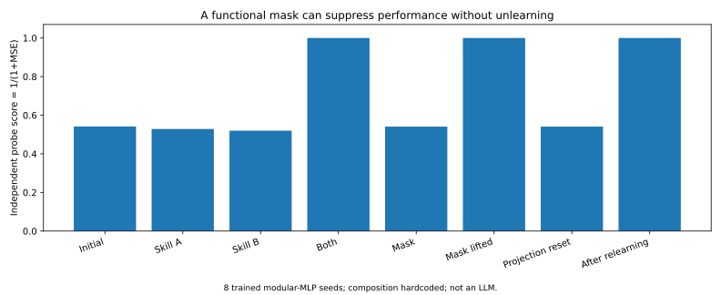

# Small genuinely trained neural learner: what a functional lesion does *not* prove

**Executed 19 November 2026; 8 PyTorch CPU training seeds. NOT a transformer or large language model.** Raw outputs: [`../results/neural/neural_module_per_seed.csv`](../results/neural/neural_module_per_seed.csv) and [`../results/neural/neural_module_summary.json`](../results/neural/neural_module_summary.json).

## Experiment

Two separate trainable tanh MLPs learn **local** rules independently: `g_square(x) ≈ 2x`, and `g_sine(u) ≈ cos(u)`. The **composition `g_square(x) * g_sine(x²)` is hardcoded by the model designer**, so this is a modular sanity-check of transfer and recoverability, **not evidence of discovered chain rule or learned neural abstractions**. From a shared initialization, independent parameter copies see none, one or both training packets. Withheld examples and a new range of scalar inputs assess the exact target derivative `d/dx sin(x²) = 2x*cos(x²)`. Training uses 225 Adam updates per exposed skill, 256 training examples per skill, and 1,024 fresh target inputs per seed. Different packets receive different numbers of updates and are **not compute-matched causal comparisons**.

Two lesions of the fully trained reference are then evaluated: (1) set the sine module's inference gate to zero, which leaves weights untouched; (2) separately set the sine output projection to zero and train that module again. The first case tests the fundamental **performance suppression ≠ knowledge erasure** confound. The second tests finite-dose recovery from actual parameter perturbation, **not validated machine unlearning**.

## Actual results

Heldout performance score is `1/(1+MSE)`, so 1.0 is ideal. Averages of **8** training seeds; see JSON for between-seed standard deviations.

| Condition | Mean held-out score |
|---|---:|
| Initial untrained | 0.541501 |
| Square derivative module trained only | 0.528550 |
| Sine derivative module trained only | 0.520021 |
| Both skill modules trained | **0.999976** |
| Both trained, out-of-training-range probes | **0.996627** |
| Both trained, sine module masked | **0.540885** |
| Mask restored, **zero gradient updates** | **0.999976** |
| Trained sine module output projection reset | **0.540885** |
| Re-trained sine module after destructive reset | **0.999971** |



**Important negative insight:** A lesion that blocks the expression of a skill can make performance collapse even though all the underlying weights remain intact. Lifting that reversible lesion restores performance **without any relearning at all**. Therefore, neither a lesion-induced loss nor an apparent rapid recovery is, by itself, proof that the skill was causally removed, stored as a particular circuit, or relearned through its prerequisites. RECON's intervention-fidelity tests and explicit uncertainty allowances are scientifically necessary.

## Reproduce

```bash
python -m pip install -e '.[test,neural]'
python -m recon.neural_pilot --out results/neural --seeds 8 --steps 225
```

These results are a proof-of-plumbing for *actual trainable neural parameters*, not an evaluation on an open-weight LLM, hidden internal skill graph, causal human learning, or paper-level methodological superiority. No neural data have been used to learn or validate the calibrated multi-channel `B` matrix.