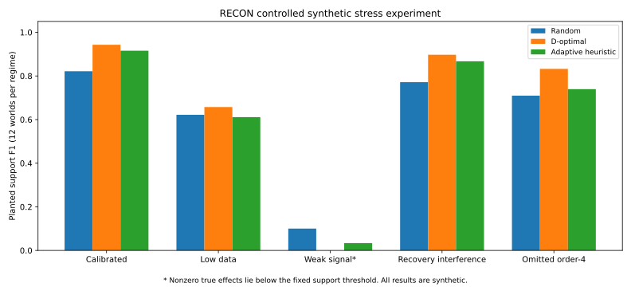

# RECON-Ω: Adversarial Pilot, Falsification, and Selection Audit

**Executed 19 November 2026. Scope: SYNTHETIC ASSAYS ONLY.** Raw results: [`../results/robustness/stress_per_world.csv`](../results/robustness/stress_per_world.csv); machine-readable settings, bootstraps and confirmation/falsification details: [`../results/robustness/stress_summary.json`](../results/robustness/stress_summary.json).

## Protocol

12 independent planted `p=6` worlds per regime; three policies (uniform random, greedy **nonadaptive** D-optimal, and an **outcome-adaptive exploratory** margin-weighted design); 48 distinct training packets per world, three channels and matched controls. All methods use the same 6×48×replicate-count Bernoulli calls per world. Default: 1,024 independent Bernoulli draws per raw action; low-replication condition: 96. The adaptive design has 12 D-optimal pilot packets, then decisions based **only on observed outcomes**, never planted coefficients. All models use the same group-lasso objective and threshold. The D-optimal policy is a standard established experimental-design method; neither method has a new proven optimality guarantee.

## Five predeclared conditions

- **Calibrated:** the simulator obeys exactly the stipulated channel loading matrix and sparse order-3 hypothesis class.
- **Low replication:** only 96 instead of 1,024 Bernoulli observations per raw action (cost is lower for **all** methods).
- **Weak signal:** planted shared effects scaled to 35% of original strength; **all nonzero true effect coefficients now lie below the fixed 0.03 support decision threshold.** Thus, near-zero F1 partly reflects **the decision rule itself**, even at infinite data. This is a stress on the inadequacy of the fixed threshold, not proof that one estimator fails due to statistical sample size.
- **Recovery interference:** an unmodeled -0.06 change to the recovery channel on a nuisance-only edge; the assumed `B` relation is violated.
- **Unmodeled arity four:** one planted true order-4 interaction is moved outside the fitting dictionary (which admits order ≤3). Exact structural recovery is unattainable without expanding the hypothesis class.

## Executed mean outcomes

Numbers are means across 12 worlds; not claimed to be confidence bounds or real LLM performance.

| Synthetic regime | Uniform F1 | D-optimal F1 | Adaptive F1 | D-optimal minimal-packet F1 | Adaptive minimal-packet F1 |
|---|---:|---:|---:|---:|---:|
| Calibrated | 0.822 | **0.943** | 0.916 | 0.820 | 0.795 |
| Low replication | 0.622 | **0.657** | 0.611 | 0.477 | **0.591** |
| Weak signal / fixed threshold | **0.100** | 0.000 | 0.033 | 0.056 | 0.083 |
| Recovery interference | 0.771 | **0.897** | 0.867 | **0.787** | 0.729 |
| Unmodeled arity four | 0.710 | **0.832** | 0.740 | **0.499** | 0.444 |



**Between-world paired-bootstrap uncertainty (10,000 resamples of 12 world seeds):** in the correctly calibrated regime, the **D-optimal minus adaptive F1** difference is 0.027 with a percentile 95% bootstrap interval **[-0.033, 0.093]**; thus this small pilot does **not** establish superiority over the adaptive heuristic. The D-optimal minus uniform difference is 0.121, interval [0.029, 0.237]. In the order-4 omission regime, the D-optimal minus adaptive difference is 0.093, interval [0.023, 0.176] on this particular generator. For every other interval see JSON. Bootstrap resamples simulated worlds, not within-run Bernoulli samples; it does not measure distribution shift to real LLMs.

## Actually discovered edge confirmation (no oracle cherry-picking)

A **separate discovery sample** selects up to three positive-support candidates **solely from estimated scores**, plus one negative-control edge selected by lowest estimated absolute effect (without using ground truth). Fresh disjoint Bernoulli samples then estimate a Möbius-interaction contrast for each selected edge. Simultaneous two-sided Hoeffding bounds use nominal α=0.05 per world, multiplicity over four preselected edges, and a declared raw-arm systematic error bound of 0.00025. Each confirmation has 60,000 Bernoulli observations **per raw action**; this is an intentionally large, cheap simulator budget and is **not comparable to 60,000 independent neural trainings**.

Results across 12 planted worlds:

- 36 estimated positive candidates checked; **36 positive certificates**, with no false-positive certificate against planted truth.
- 12 estimated-near-zero negative controls checked; **12 truly zero in these worlds**, **0 positive certificates**.
- All 48 intervals cover their corresponding planted structural effect; the combined confirmation used **47,520,000 simulated Bernoulli draws** (cheap aggregated binomial generation, not millions of model copies).
- These outcomes demonstrate internal correctness on the planted calibrated simulator; n=12 worlds is far too small to claim a validated real-world false-discovery rate.

The certificate **does not identify an internal neural circuit**, nor guarantee latent-edge coverage if intervention bias exceeds its stipulated allowance, cross-channel loading is wrong, or hidden packet interactions are missing.

## Independent fourth-action falsification

The original fourth-action projection was **incorrectly implemented** as `solve(B, B4)` instead of the mathematically required `solve(B.T, B4)`; this release fixes the formula and adds a regression test. The synthetic fourth arm uses its own Bernoulli baseline of `0.30` so every generated probability is valid. Accordingly the previously posted fourth-action mean absolute errors are **superseded** by these corrected results from `results/summary.json`: uniform **0.0237** and D-optimal **0.0081** (12 worlds). The three-channel F1 means are unchanged.

To test sensitivity of a fixed fourth-arm diagnostic separately from coefficient-estimation errors, each of 12 worlds underwent a **known-parameter oracle-calibrated** independent Bernoulli test with 6,000 draws. The unperturbed action was rejected **0/12** times; an independently imposed **+0.08 fourth-action response deviation** was detected **12/12** times. This confirms a controlled calibration check, **not** that RECON detects neural model misspecification when its own calibration is unknown.

## Interpretation and failure criteria

1. D-optimal is at least competitive with this simple active policy; do **not** claim that the adaptive procedure is novel or state of the art.
2. Finite-world uncertainty intervals are wide and some include zero. Report both negative and positive findings.
3. A fixed detection threshold can make weak true effects literally impossible to call positive. Threshold selection and sensitivity analysis must be preregistered or evaluated separately.
4. The wrong response family / omitted order-4 term produces unavoidable approximation problems; do not present high aggregate F1 as exact identification of the full hypergraph.
5. Failure to reproduce advantages under real model updates, leak-calibrated lesions or strong active factorial comparators would rule out RECON's current performance claims. The next research milestone is genuinely trainable learner studies and prospective, independently calibrated intervention predictions.

## Reproduction

```bash
python -m pip install -e '.[test,plot]'
pytest -q tests
python -m recon.experiments --out results --seeds 12 --packets 48 --replicates 1024 --confirm-replicates 60000
python -m recon.robustness --out results/robustness --seeds 12 --packets 48 --confirmation-replicates 60000 --fourth-trials 6000
```