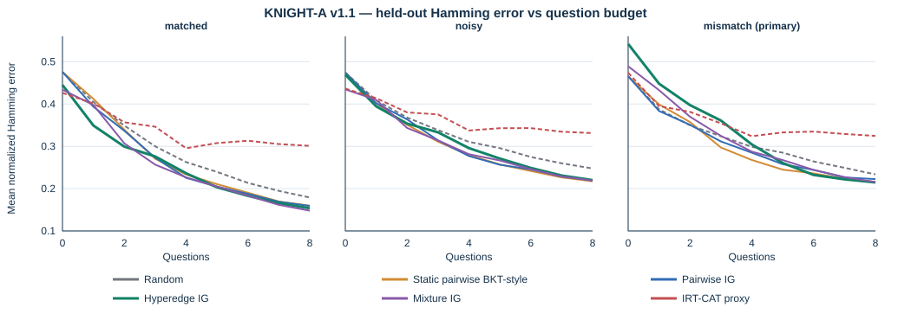

# KNIGHT-A v1.1: Prerequisite-Aware Adaptive Assessment under Structural Uncertainty
Mohammad Amanlou | 27 November 2026 | Research plan for Andrey Ustyuzhanin

## 1. Question and model
Can source-traceable KNIGHT adaptive assessment recover concept mastery better using a soft conjunctive prerequisite prior than an additive pairwise prior at the same question budget, when structure and response assumptions may be wrong? We use 20 original KNIGHT linear-algebra recognition questions, 11 semantic families, six binary skills and 47 source triples. Candidate prerequisite sets: {S1,S2}->S3; S2->S4; {S2,S3}->S5; {S2,S4}->S6. Tags and edges are curator hypotheses, not validated learning dependencies.

Let Z be a 6-bit static learner profile. Roots have Bernoulli probability r. Children have probability sigmoid(b+w f(parents)), with f the parent mean (additive) or product (conjunctive). Both model families have five parameters (r,b,w,slip,guess) and common DINA likelihood form. For item q, likelihood L_q(z)=g+(1-s-g) product of mastered Q-tagged skills. Update the 64-state posterior by Bayes' rule; select the eligible item maximizing I(Z;Y|history,q)=h(E L_q)-E h(L_q). No repeat semantic family. Mixture IG maintains joint posterior over both models, marginalizing model identity before computing mastery information gain. Estimate per-skill probabilities and threshold at 0.5 for Hamming loss.

The contribution is integration and evaluation with source provenance and deliberately mismatched worlds, not a new claim about general hypergraph expressivity. Hierarchical diagnosis, information-gain CD-CAT and minimum expected risk already exist. A pairwise DAG can encode conjunctive CPDs. As a testable future extension, the Bayes Hamming risk R(p)=sum_j min(p_j,1-p_j)/6 suggests selecting q by R(p)-E_Y R(p|Y,q). Nonnegativity follows by concavity and posterior-marginal martingales; this is not a novel theorem or an evaluated v1.1 policy. Extend to independently calibrated structural uncertainty and unseen topics.

## 2. Frozen pilot and evidence
30 development worlds (3,000 learners), 32-point grid per prior family on fixed random histories minimizing Brier, and 60 disjoint held-out worlds (6,000 learners), 20 per regime. Matched: conjunctive graph and DINA; noisy: heterogeneous slip/guess and latent ability; mismatch: deleted prerequisite, additive generator and compensatory logistic responses. Same potential responses and eight distinct families for all six methods; unit of replication is world, paired bootstrap 10,000 draws. The primary endpoint is mismatch pairwise-minus-hyperedge Hamming at budget 8. Secondary: exact recovery, censored first-exact questions, Brier and ECE. Static BKT-style has no learning transitions; IRT-CAT is a supervised scalar synthetic proxy. The model mixture is a secondary prespecified comparator, not graph discovery.

Mismatch final metrics:

| Method | Hamming | Exact | Brier | ECE |
|---|---:|---:|---:|---:|
|Random|.2337|.2435|.1656|.0725|
|Static pairwise BKT-style|.2161|.2785|.1610|.0879|
|Pairwise IG|.2225|.2665|.1642|.0927|
|Hyperedge IG|.2146|.2645|.1567|.0677|
|Mixture IG|.2153|.2690|.1601|.0742|
|IRT-CAT proxy|.3246|.1595|.2072|.0648|

Primary difference .00792, 95% CI [.00158,.01383]. Matched .00550 and noisy -.00067, both intervals include zero. Mixture mismatch .00717, CI includes zero. Hyperedge exact recovery is slightly worse than pairwise IG; censored first-exact recovery 6.798 vs 6.642 (failure=9). Different fitted parameters imply a calibrated-pipeline contrast rather than a causal effect of conjunction alone. A numerical reimplementation using original sorted Q-tags/families reproduced the fitted tuples, all 18 reported final Hamming means and primary CI on 27 Nov. Original raw histories were unavailable in this delivery environment. The original frozen benchmark and audit remain unchanged.

Next: independent double annotation and more demanding executable items, estimate item/edge uncertainty using consented development responses, compare calibrated CD-CAT/risk selection and temporal BKT where learning occurs, preregister unseen-topic and calibration/precision-based stopping tests. Report unresolved/falsified edges; no human effectiveness or general novelty claim yet.

References: [KNIGHT](https://proceedings.mlr.press/v328/amanlou26a.html), [Templin & Bradshaw (2014)](https://doi.org/10.1007/s11336-013-9363-z), [Wang (2013)](https://doi.org/10.1177/0013164413498256), [Hsu & Wang (2022)](https://doi.org/10.1177/01466216211066610).
